# Manual de uso do SEC EBTT

Progressão, Promoção, RSC e Classe Titular. Edição de 7 de novembro de 2026.

Roteiro ilustrado para uso pelo orientador e pelos participantes dos processos. Os prints mostram dados fictícios de uma cópia da base demonstrativa. As credenciais e os pontos de partida estão nos dois últimos capítulos.

## Mapa do manual

1. Começar com os cenários preparados — página 3 do PDF
2. Entrar e trocar de perfil — página 4 do PDF
3. Conferir perfil e cadastrar diplomas — página 5 do PDF
4. Abrir uma Progressão — página 6 do PDF
5. Preencher a pontuação de carreira — página 7 do PDF
6. Anexar e reutilizar comprovantes — página 8 do PDF
7. Localizar atividades Qualis — página 9 do PDF
8. Revisar enviar e acompanhar — página 10 do PDF
9. Abrir a análise de carreira — página 11 do PDF
10. Reconhecer a pontuação pela CPPD — página 12 do PDF
11. Gerar o parecer e finalizar carreira — página 13 do PDF
12. Consultar a conclusão de carreira — página 14 do PDF
13. Executar uma Promoção — página 15 do PDF
14. Abrir um RSC — página 16 do PDF
15. Preparar o memorial e os documentos do RSC — página 17 do PDF
16. Pontuar as atividades do RSC — página 18 do PDF
17. Constituir a Comissão Especial — página 19 do PDF
18. Aceitar ou recusar a participação — página 20 do PDF
19. Avaliar individualmente um RSC — página 21 do PDF
20. Avaliar individualmente a Classe Titular — página 22 do PDF
21. Gerar assinar e conferir documentos — página 23 do PDF
22. Concluir a comissão e decidir o RSC — página 24 do PDF
23. Apresentar e acompanhar recursos do RSC — página 25 do PDF
24. Abrir a Promoção à Classe Titular — página 26 do PDF
25. Preencher requerimento desempenho e doutorado — página 27 do PDF
26. Cadastrar os sete indicados — página 28 do PDF
27. Fazer a análise prévia da Classe Titular — página 29 do PDF
28. Seguir as modalidades Memorial e Tese — página 30 do PDF
29. Pedir reavaliação do memorial — página 31 do PDF
30. Agendar e registrar uma defesa — página 32 do PDF
31. Recorrer e concluir a Classe Titular — página 33 do PDF
32. Administrar usuários e vínculos da CPPD — página 34 do PDF
33. Manter tabelas calendário e documentos — página 35 do PDF
34. Resolver pendências frequentes — página 36 do PDF
35. Credenciais de gestão e avaliação — página 37 do PDF
36. Contas docentes e pontos de partida — página 38 do PDF

## 1 Começar com os cenários preparados

**Quem faz:** Todos os perfis.

Este manual acompanha o teste do SEC EBTT pelo orientador. Ele explica os quatro tipos de processo, as ações de cada participante e o caminho até o resultado. As contas e os números dos cenários estão nos dois últimos capítulos.

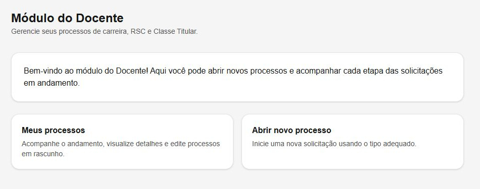

*Página inicial do docente com os acessos para consultar e abrir processos.*

### Como fazer

1. Escolha um cenário no apêndice. Os processos 1, 4, 7 e 10 estão em rascunho e servem para praticar o preenchimento e o envio.
2. Para começar pela CPPD, use os processos 2, 5, 8 ou 11. Os processos 3 e 6 têm análise de carreira iniciada; 9 e 12 têm comissão ativa e pareceres pendentes.
3. Para testar um cenário já criado, abra Consultar processos e entre em Detalhes. A abertura de uma nova solicitação é um percurso separado; o sistema impede outro processo ativo do mesmo tipo para a mesma pessoa.
4. Use Sair antes de trocar de conta. Abas de uma mesma sessão compartilham o usuário conectado. Confira sempre o módulo e o número do processo antes de salvar.

**Resultado esperado:** Você sabe qual conta usar, em que etapa começar e quem deve executar a próxima ação.

**Orientação:** Os dados, CPFs e PDFs deste ambiente são fictícios. As telas foram registradas em uma cópia da base demonstrativa para ilustrar também etapas posteriores. A base do orientador conserva os cenários iniciais.

**Orientação:** Use o endereço informado por Julio para o sistema publicado. O endereço local que aparece nos prints identifica apenas o ambiente de captura.

## 2 Entrar e trocar de perfil

**Quem faz:** Todos os perfis.

As contas de demonstração entram por CPF e senha. As senhas do apêndice são as da carga inicial; uma senha alterada durante o teste deve ser substituída pela senha atual.

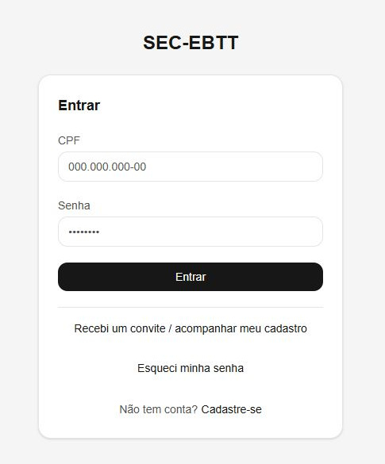

*Acesso por CPF e senha da conta demonstrativa.*

### Como fazer

1. Na tela Entrar, preencha o CPF da conta escolhida e sua senha. Clique em Entrar.
2. Se aparecer uma seleção de perfil, escolha o papel com o qual executará a tarefa: Docente, CPPD, Administração ou Avaliações.
3. Confira o nome do módulo. O avaliador interno utiliza a conta com perfil Docente e abre Minhas avaliações. O externo entra no módulo de Avaliações.
4. Para mudar de pessoa, abra o botão PF e clique em Sair. Entre novamente com a conta da próxima etapa.
5. Se a senha falhar, confira a conta e a digitação. Esqueci minha senha depende da entrega de e-mail configurada; não é necessário usar essa opção para os testes com as senhas iniciais.

**Resultado esperado:** A sessão corresponde à pessoa e ao perfil que devem atuar no processo.

## 3 Conferir perfil e cadastrar diplomas

**Quem faz:** Docente.

Os dados funcionais orientam as regras de abertura. A biblioteca de titulações permite reutilizar um diploma em diferentes solicitações.

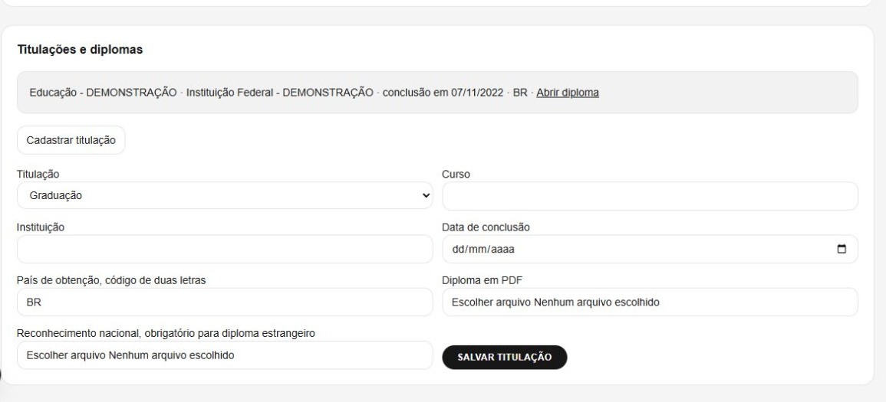

*Biblioteca do docente com os campos de cadastro da titulação.*

### Como fazer

1. Abra PF e Editar perfil para conferir identificação, contato, campus, classe e início do interstício. Corrija um dado apenas se ele estiver incorreto; a conta precisa continuar compatível com o cenário escolhido.
2. Abra a biblioteca de titulações pelo link apresentado no perfil. Em Titulações e diplomas, clique em Cadastrar titulação.
3. Escolha o nível, informe curso, instituição e data de conclusão. Para um doutorado, selecione Doutorado.
4. Informe o país de obtenção, como BR, e selecione o diploma em PDF. Se o título for estrangeiro, anexe também o reconhecimento nacional.
5. Clique em Salvar titulação. Abra o diploma da lista para conferir o arquivo salvo. Depois selecione esse título no processo que o exigir.

**Resultado esperado:** A titulação aparece na biblioteca, com seu diploma e, quando necessário, o reconhecimento nacional.

**Orientação:** Os docentes da demonstração já têm os títulos e anexos necessários aos seus cenários. Para seguir o roteiro pronto, confira os registros existentes antes de cadastrar outro.

## 4 Abrir uma Progressão

**Quem faz:** Docente.

A Progressão movimenta o docente entre níveis da mesma classe. O exemplo preparado é B1 para B2, com interstício completo. Para usar o rascunho existente, entre na conta do processo 1 e vá diretamente aos detalhes.

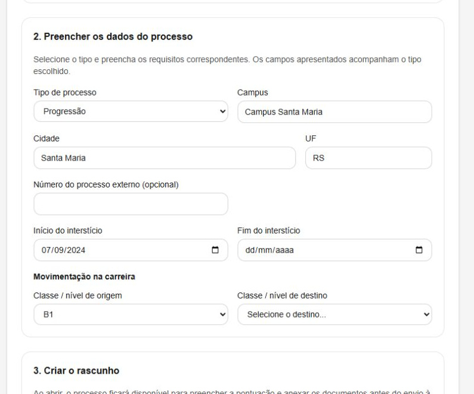

*Campos de período e movimentação apresentados para Progressão.*

### Como fazer

1. Para uma nova solicitação, abra Abrir processo e revise os dados pessoais e funcionais apresentados.
2. Em Tipo de processo, escolha Progressão. Confira campus, cidade e UF. Informe o número externo, se houver.
3. Preencha início e fim do interstício. A origem precisa coincidir com a classe e o nível atuais do cadastro; selecione o destino permitido pelo formulário.
4. No exemplo B1 para B2, a concessão exige 24 meses completos. A preparação antecipada permitida pelo sistema não autoriza deferimento antecipado.
5. Clique em Abrir processo. Anote o número gerado e confira tipo, período e movimentação na tela de detalhes.

**Resultado esperado:** O processo fica em Rascunho, pronto para receber pontuação e comprovantes.

**Orientação:** O sistema verifica a janela de preparação de carreira de até 60 dias antes do término do interstício. Utilize as datas funcionais reais da solicitação, em vez de copiar as datas dos prints.

## 5 Preencher a pontuação de carreira

**Quem faz:** Docente.

Nos detalhes do rascunho, abra Preencher pontuação. Os mesmos controles de pontuação são usados em Progressão e Promoção.

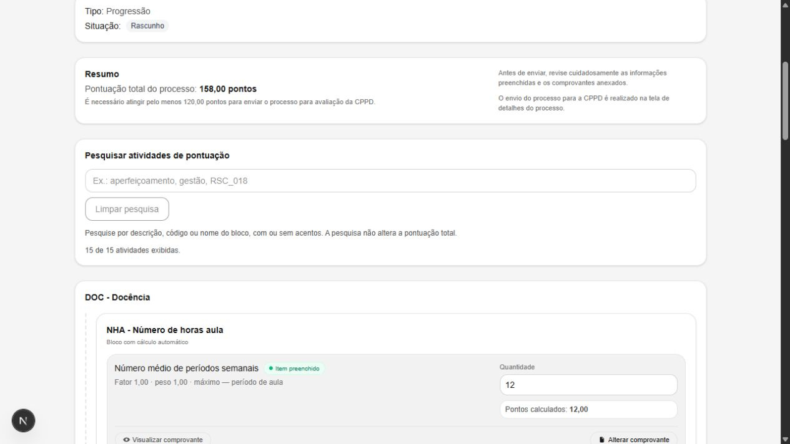

*Pesquisa de atividades, resumo e itens de um bloco com cálculo automático.*

### Como fazer

1. Use a pesquisa para localizar a atividade por descrição, código ou bloco.
2. Anexe primeiro o comprovante da atividade. Em seguida, informe a quantidade solicitada pelo item ou os pontos finais quando houver limite de pontuação.
3. Confirme a gravação do item e aguarde a atualização dos pontos calculados. Repita o procedimento para todas as atividades que compõem o pedido.
4. Nos blocos com fórmula, informe as quantidades de cada variável. O total do bloco é calculado pelo sistema; os valores exibidos em cada linha não devem ser somados novamente por fora da fórmula.
5. Confira os totais dos blocos e o resumo geral. O cenário de carreira preparado tem 158 pontos; o mínimo para enviar e, depois, deferir é de pelo menos 120 pontos, respeitada a avaliação da CPPD.

**Resultado esperado:** Os itens declarados têm comprovantes e o resumo reflete a pontuação calculada.

**Orientação:** No exemplo de docência, as quantidades alimentam a expressão (MNP + MND × 2 + NT) × NSI. Use a descrição de cada variável exibida na tela.

## 6 Anexar e reutilizar comprovantes

**Quem faz:** Docente.

Cada atividade pontuada precisa estar vinculada ao arquivo que a comprova. O gerenciador permite enviar um novo arquivo ou reutilizar um já incluído pela própria pessoa.

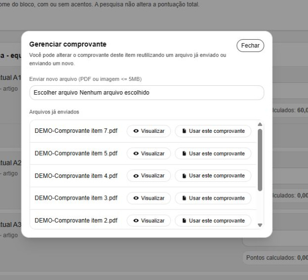

*Gerenciador com envio de arquivo e reutilização de comprovantes.*

### Como fazer

1. No item, abra a opção de comprovante. Em um item preenchido, Alterar comprovante abre o gerenciador.
2. Para um documento novo, clique em Enviar novo arquivo, selecione o arquivo permitido e aguarde a conclusão.
3. Para reutilizar, localize o arquivo em Arquivos já enviados, clique em Visualizar para conferir seu conteúdo e depois em Usar este comprovante.
4. Volte ao item e use Visualizar comprovante para verificar o vínculo. A alteração deve apontar para o documento correto antes do envio do processo.

**Resultado esperado:** O item passa a exibir o comprovante escolhido e o arquivo pode ser consultado pela tela autorizada.

**Orientação:** O campo de comprovantes informa PDF ou imagem de até 5 MB. Os documentos específicos dos processos pedem PDF de até 5 MB. Titulações e assinaturas têm seus próprios campos e limites; siga a indicação do controle.

**Orientação:** Se o navegador não mostrar o PDF incorporado, confira o arquivo pelo link de abertura ou download em um navegador com leitor de PDF.

## 7 Localizar atividades Qualis

**Quem faz:** Docente.

A tabela de carreira demonstrativa contém o recorte de atividades já usado no projeto e os itens de equivalência Qualis.

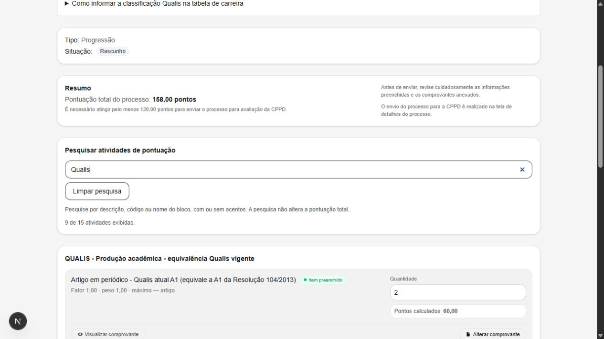

*Filtro Qualis e exemplo de artigo A1 com quantidade declarada.*

### Como fazer

1. Na página de pontuação, digite Qualis na pesquisa de atividades.
2. Leia a descrição completa do item. Ela indica a classificação atual e sua equivalência na tabela de referência utilizada pelo sistema.
3. Escolha a categoria correspondente ao artigo e anexe o comprovante. Informe a quantidade, confirme o registro e confira os pontos calculados.
4. Clique em Limpar pesquisa para voltar a todas as atividades. O filtro muda o que aparece na tela e preserva o total geral do processo.

**Resultado esperado:** A produção acadêmica está no item correspondente à classificação informada.

**Orientação:** O catálogo de carreira desta demonstração tem 15 itens e não constitui a transcrição integral da tabela institucional. O catálogo RSC, apresentado em capítulo próprio, contém os 82 critérios.

## 8 Revisar enviar e acompanhar

**Quem faz:** Docente.

O envio à CPPD é realizado nos detalhes do processo. Salvar pontuação ou anexar arquivos, isoladamente, mantém a solicitação em preparação.

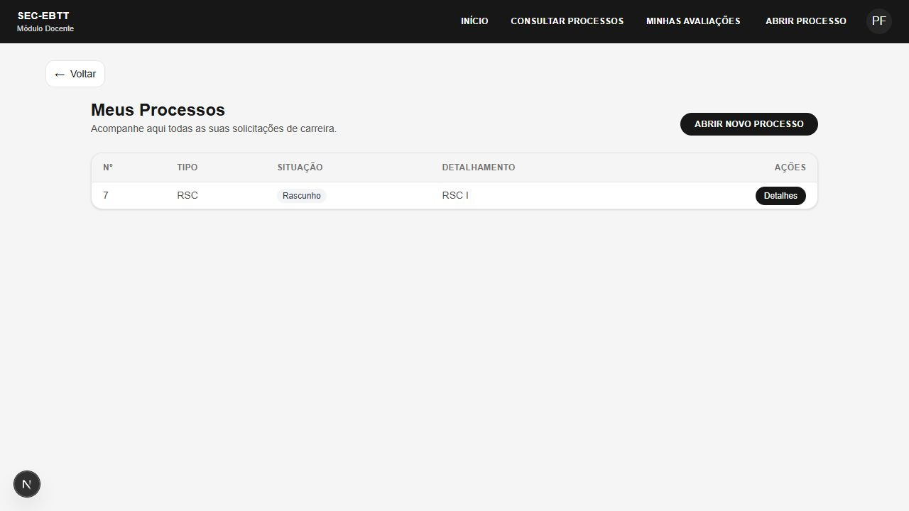

*Lista do docente com tipo, situação e acesso aos detalhes.*

### Como fazer

1. Volte aos detalhes e confira o tipo, o período, a origem, o destino e o resumo da pontuação.
2. Revise os arquivos e os documentos exigidos pela configuração do tipo de processo. Se precisar, use Editar dados enquanto a etapa permitir.
3. Clique em Enviar processo para análise e confirme a ação quando solicitado. Corrija as pendências que o sistema apontar e tente novamente.
4. Abra Consultar processos e verifique a nova situação. A solicitação enviada passa a integrar a fila da CPPD.
5. Depois do envio, acompanhe o resultado nos detalhes. Os dados enviados ficam protegidos; se houver devolução em uma etapa permitida, faça somente os ajustes liberados pelo sistema.

**Resultado esperado:** A situação muda de Rascunho para Enviado e a CPPD consegue consultar o pedido.

**Orientação:** Use Excluir processo somente para um rascunho descartável. Excluir o cenário principal impede seguir seu restante.

## 9 Abrir a análise de carreira

**Quem faz:** CPPD local ou CPPD Central.

A CPPD consulta o material enviado pelo docente e registra sua avaliação. O acesso local depende do vínculo vigente com o campus do processo.

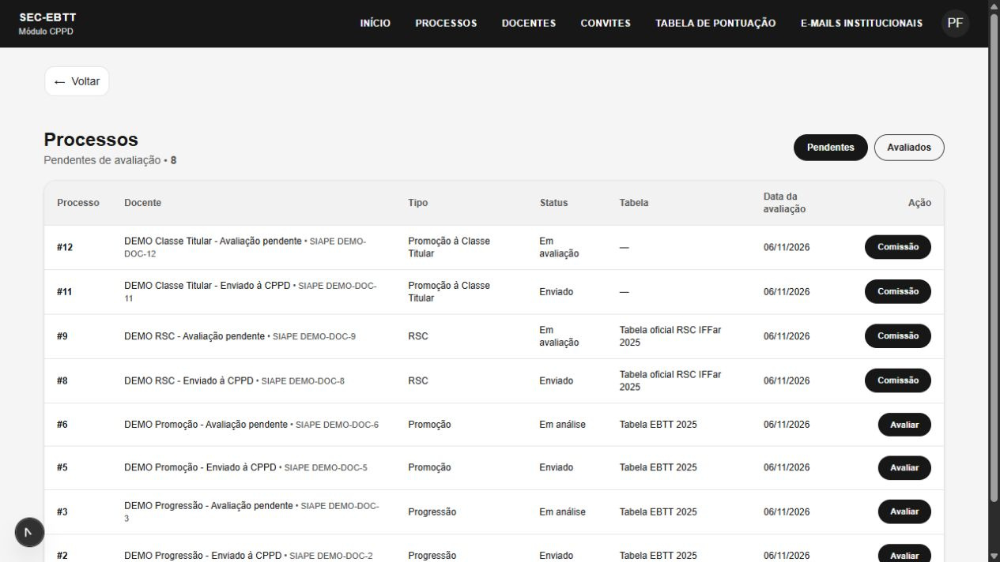

*Fila demonstrativa com Progressão, Promoção, RSC e Classe Titular.*

### Como fazer

1. Entre como CPPD e abra Processos. A aba Pendentes reúne as solicitações que ainda aguardam conclusão.
2. Localize o número, o docente e o tipo. Para Progressão ou Promoção, clique em Avaliar.
3. Confira os dados funcionais, o interstício e a movimentação. Abra os comprovantes dos itens preenchidos pelo docente.
4. Use os cenários 3 ou 6 para continuar uma análise iniciada. Nos cenários 2 e 5, comece a conferência do material enviado.

**Resultado esperado:** A tela Avaliação da CPPD mostra os itens declarados e o espaço para reconhecer a pontuação.

**Orientação:** A CPPD local fica limitada ao campus autorizado. A CPPD Central tem a visão correspondente ao seu perfil. A conta Administrador administra cadastros e configurações.

## 10 Reconhecer a pontuação pela CPPD

**Quem faz:** CPPD.

Selecione uma atividade preenchida para visualizar o comprovante e registrar os pontos reconhecidos.

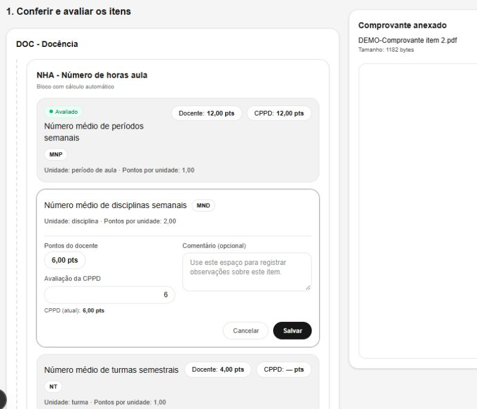

*Detalhe de um item com pontuação reconhecida e ação de salvar.*

### Como fazer

1. Clique no item. Examine o arquivo apresentado no painel de comprovante.
2. No campo Avaliação da CPPD, informe a pontuação reconhecida para aquela linha. Se o valor divergir do declarado, registre a justificativa solicitada.
3. Clique em Salvar e confirme a atualização do item e do total avaliado.
4. Repita para todos os itens preenchidos. Verifique o contador Itens avaliados até que ele indique a conclusão de toda a lista.
5. Confira o resumo final da CPPD. Para deferir carreira, o total reconhecido deve atingir pelo menos 120 pontos e os demais requisitos devem estar cumpridos.

**Resultado esperado:** Todos os itens declarados estão avaliados e o comando Gerar parecer fica disponível.

**Orientação:** Em carreira, o campo da CPPD registra pontos reconhecidos. Na avaliação individual do RSC, o avaliador informa a quantidade reconhecida e o sistema calcula os pontos.

## 11 Gerar o parecer e finalizar carreira

**Quem faz:** CPPD.

Depois de avaliar todos os itens, gere a prévia e revise os dados da decisão antes de confirmar.

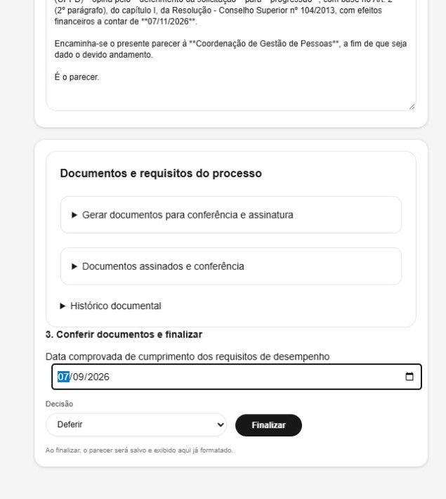

*Campos finais de documentos, data de cumprimento e decisão.*

### Como fazer

1. Clique em 3. Gerar parecer na avaliação. Na página Parecer da CPPD, confira o resumo e os avaliadores indicados.
2. Revise o texto e use Atualizar prévia se alterar as informações disponibilizadas para edição.
3. Confira os documentos exigidos para o processo e informe a data comprovada de cumprimento dos requisitos de desempenho.
4. Selecione Deferir ou Indeferir. A decisão precisa corresponder aos requisitos efetivamente conferidos; o sistema bloqueia o deferimento sem pontuação ou interstício suficientes.
5. Clique em Finalizar. Leia a confirmação e confirme somente após revisar o processo correto.

**Resultado esperado:** O parecer e a decisão são registrados; o processo passa à consulta de avaliados.

**Orientação:** A data financeira é calculada considerando as datas dos requisitos e do interstício. Não escolha uma data apenas para contornar uma pendência.

## 12 Consultar a conclusão de carreira

**Quem faz:** CPPD e docente.

Após a confirmação, o parecer passa a ser uma informação persistida do processo.

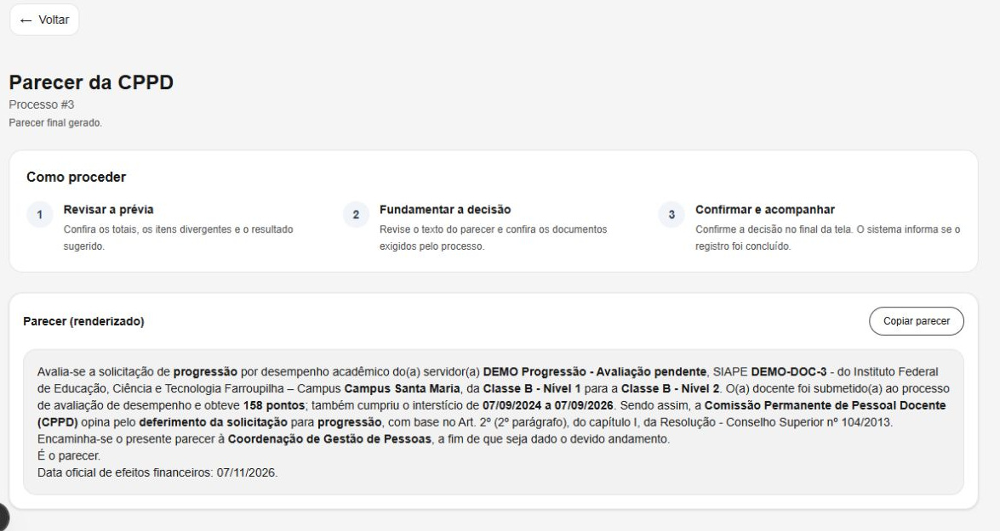

*Parecer de carreira após confirmação do deferimento na cópia do manual.*

### Como fazer

1. Na CPPD, abra Processos e a aba Avaliados para localizar a solicitação concluída.
2. Abra a consulta do parecer e confira resultado, pontuação final, fundamentação e datas. Use a opção de copiar ou gerar o documento que estiver disponível.
3. Entre novamente como docente e confira o resultado nos detalhes. Em um deferimento, verifique também a atualização funcional correspondente.
4. Para outra rodada de teste, use outro cenário ou peça a restauração da base demonstrativa. A reexecução da seed preserva o andamento dos cenários existentes.

**Resultado esperado:** O resultado pode ser consultado pelos participantes autorizados e os dados concluídos ficam preservados.

## 13 Executar uma Promoção

**Quem faz:** Docente e CPPD.

A Promoção comum utiliza o fluxo de carreira para a passagem entre classes permitidas. O cenário de demonstração usa B4 para C1.

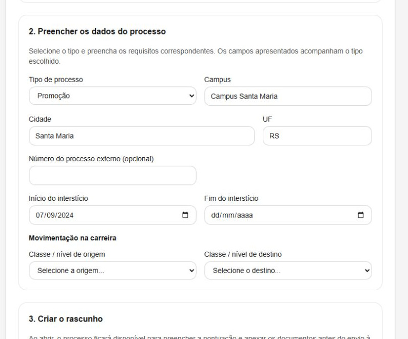

*A seleção Promoção apresenta as movimentações próprias desse tipo.*

### Como fazer

1. Para continuar o cenário pronto, use o rascunho 4, o enviado 5 ou a análise iniciada 6. As contas constam no apêndice.
2. Para uma nova solicitação, abra Abrir processo, escolha Promoção e revise os dados funcionais e o campus.
3. Preencha o período e escolha a origem e o destino oferecidos. B4 para C1 exige 24 meses; A1 para B1 exige 36 meses.
4. Abra o rascunho, anexe comprovantes e preencha a pontuação. Revise o mínimo de 120 pontos antes de enviar.
5. A CPPD abre Avaliar, reconhece todos os itens, gera a prévia e confirma a decisão, seguindo as etapas de carreira dos capítulos anteriores.
6. Após a conclusão, confira a nova classe quando houver deferimento. Para C4 para Titular, use o tipo Promoção à Classe Titular e seu rito específico.

**Resultado esperado:** A Promoção percorre abertura, comprovação, análise e decisão com origem e destino compatíveis.

## 14 Abrir um RSC

**Quem faz:** Docente.

O RSC solicita reconhecimento de saberes e competências em um nível pretendido. Os exemplos são RSC I no processo 7, RSC II no 8 e RSC III no 9.

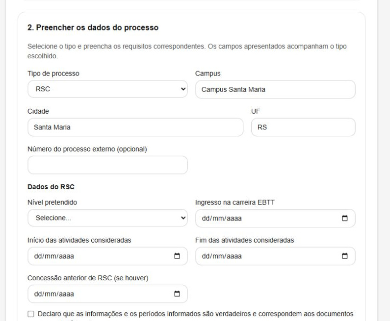

*Campos próprios do RSC, com nível, ingresso, período e declaração.*

### Como fazer

1. Para uma nova solicitação, abra Abrir processo e escolha RSC. Confira campus, cidade, UF e referência externa, se houver.
2. Selecione o nível pretendido compatível com sua titulação: RSC I exige graduação; RSC II, especialização ou formação superior correspondente; RSC III, mestrado ou doutorado.
3. Informe o ingresso na carreira EBTT e o início e fim das atividades consideradas. Atividades anteriores ao ingresso têm o limite implementado de cinco anos.
4. Se houver RSC anterior, informe a data da concessão. O novo período deve respeitar o início nessa concessão ou depois e o intervalo mínimo de três anos previsto pelo sistema.
5. Leia e confirme a declaração de veracidade. Clique em Abrir processo e confira o nível salvo nos detalhes.

**Resultado esperado:** O rascunho RSC fica vinculado à tabela vigente e ao nível pretendido informado.

## 15 Preparar o memorial e os documentos do RSC

**Quem faz:** Docente.

O relatório descritivo ou memorial e os comprovantes das atividades compõem o material que será analisado pela comissão.

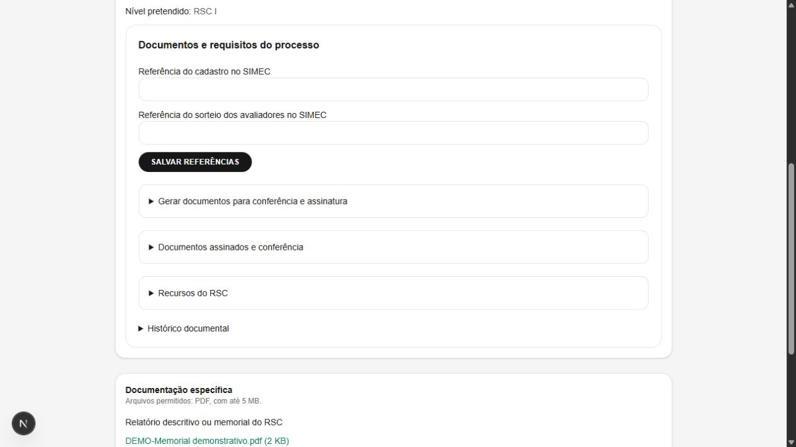

*Painel de referências, documentos e memorial do RSC.*

### Como fazer

1. Nos detalhes, abra Documentação específica e selecione o relatório descritivo ou memorial em PDF.
2. Conclua o envio ou a substituição e abra o link salvo para conferir se é o documento correto.
3. Preencha as referências do cadastro e do sorteio no SIMEC quando houver registros correspondentes. Salve as referências.
4. Em Gerar documentos para conferência e assinatura, gere os documentos disponíveis para sua etapa e confira os dados.
5. Complete a pontuação e seus comprovantes. Volte aos detalhes, revise o resumo e envie o processo para análise.

**Resultado esperado:** O pedido enviado contém o nível, o período, o relatório ou memorial e a documentação das atividades.

**Orientação:** SIMEC e SIPAC são referências registradas pelo usuário. O SEC EBTT não faz o cadastro externo, o sorteio ou a assinatura automaticamente.

## 16 Pontuar as atividades do RSC

**Quem faz:** Docente.

A tabela RSC demonstrativa contém os 82 critérios organizados por nível e diretriz. A avaliação considera os fatores, pesos e tetos desses critérios.

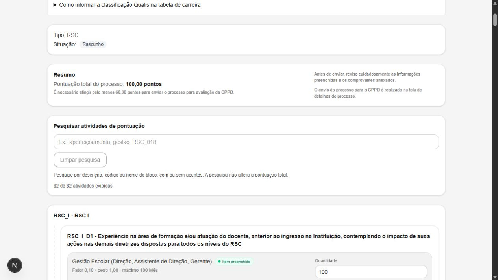

*Resumo do RSC e critérios com fator, peso e quantidade máxima.*

### Como fazer

1. Abra Preencher pontuação e pesquise a atividade que corresponde ao comprovante.
2. Vincule o PDF da atividade e informe a quantidade declarada, respeitando o máximo indicado na tela.
3. Confira o cálculo e os limites dos blocos. O sistema aplica os tetos de diretriz e nível ao total.
4. Antes do envio, alcance pelo menos 60 pontos no total e pelo menos 36 no nível pretendido. Os pontos desse nível já integram o total.
5. Revise a coerência entre quantidade, período e documento. Envie pelo botão dos detalhes quando os requisitos estiverem completos.

**Resultado esperado:** O processo atende às regras de envio e conserva os comprovantes que a comissão avaliará.

**Orientação:** Nos exemplos preparados, a pontuação declarada é 100. O reconhecimento da comissão continua pendente nos cenários iniciais.

## 17 Constituir a Comissão Especial

**Quem faz:** CPPD.

RSC e Classe Titular usam uma Comissão Especial por processo. Ela é diferente da comissão local da CPPD que define o acesso ao campus.

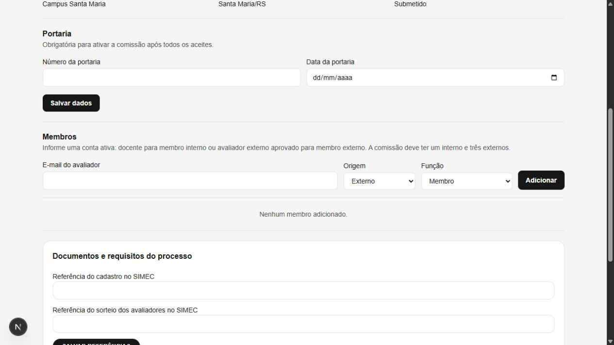

*Cadastro de membros por e-mail, origem e função.*

### Como fazer

1. Em Processos, localize a solicitação e abra Comissão. Confira docente, número e tipo.
2. Registre o número e a data da portaria e clique em Salvar dados.
3. Em Membros, informe o e-mail de uma conta ativa e elegível, escolha a origem e a função e clique em Adicionar.
4. Complete exatamente um interno e três externos. Na Classe Titular, o interno exerce a presidência e os quatro membros devem corresponder aos titulares da lista validada.
5. Acompanhe os aceites. Depois de todos aceitarem e de as verificações exigidas estarem concluídas, use a ação de ativar a comissão.
6. Confira a situação Ativa e o prazo da comissão. Na Classe Titular, a análise de desempenho, doutorado e indicados deve estar aprovada antes dessa ativação.

**Resultado esperado:** Os quatro avaliadores aceitos recebem acesso às avaliações individuais da comissão ativa.

**Orientação:** Nos cenários iniciais 9 e 12, a portaria, a composição e os aceites já estão preparados. Para praticar a montagem, comece pelo processo 8 ou 11.

## 18 Aceitar ou recusar a participação

**Quem faz:** Avaliador interno ou externo.

O convite de participação na comissão aparece em Minhas avaliações. Ele é uma tarefa vinculada a um processo específico.

*Confirmação do aceite com declaração de ausência de conflito.*

### Como fazer

1. O interno entra na conta Docente e abre Minhas avaliações. O externo entra diretamente no módulo de Avaliações.
2. Confira o processo, o requerente, o campus e a função no cartão do convite.
3. Para aceitar, clique em Aceitar e leia a declaração de ausência de conflito ou impedimento. Confirme apenas se a declaração for verdadeira.
4. Se houver impedimento, clique em Recusar e informe o motivo solicitado para que a CPPD possa providenciar a substituição.
5. Após o aceite, aguarde a ativação da comissão. Quando o cartão indicar Avaliação disponível, abra Avaliar.

**Resultado esperado:** A CPPD visualiza a resposta e o avaliador participa apenas dos processos para os quais foi designado.

**Orientação:** As contas da demonstração já estão ativas. Para um novo externo, a administração pode usar Convites, preencher campus, nome, e-mail e perfis, conferir a instituição e enviar o acesso. Depois do preenchimento pelo destinatário, deve conferir os dados profissionais e aprovar o cadastro. A entrega de e-mail e as verificações de primeiro acesso dependem da configuração do ambiente.

## 19 Avaliar individualmente um RSC

**Quem faz:** Cada um dos quatro avaliadores.

O parecer RSC combina o reconhecimento das quantidades com uma fundamentação escrita. Cada membro executa sua própria avaliação.

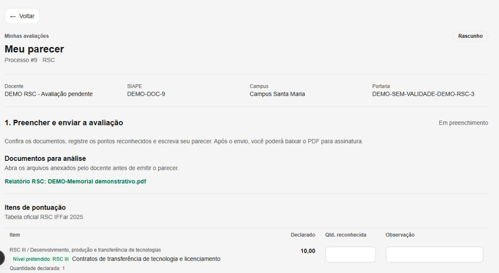

*Avaliação RSC com documentos e campos de quantidade reconhecida.*

### Como fazer

1. Abra Avaliar no cartão do processo RSC e consulte o memorial e os comprovantes do requerente.
2. Para cada atividade declarada, informe a quantidade reconhecida. Ela deve ficar entre zero e a quantidade declarada. Use a observação para explicar uma divergência.
3. Acompanhe o total e os pontos do nível pretendido. O resultado é calculado pela regra de 60 pontos totais e 36 no nível solicitado.
4. Escreva o Parecer individual. Use Salvar rascunho para continuar depois, ou Enviar avaliação quando a análise estiver concluída.
5. Após enviar, confira a situação. O parecer enviado fica protegido. Baixe o PDF disponibilizado para assinatura e siga a etapa documental.

**Resultado esperado:** A comissão recebe um parecer individual enviado, com quantidades reconhecidas, resultado calculado e fundamentação.

**Orientação:** Repita com o interno 1 e os três externos titulares indicados no apêndice. O requerente não pode avaliar o próprio processo.

## 20 Avaliar individualmente a Classe Titular

**Quem faz:** Cada um dos quatro avaliadores.

A avaliação da Classe Titular utiliza o trabalho apresentado e os documentos do processo. O avaliador registra resultado e parecer, sem lançar quantidades de itens RSC.

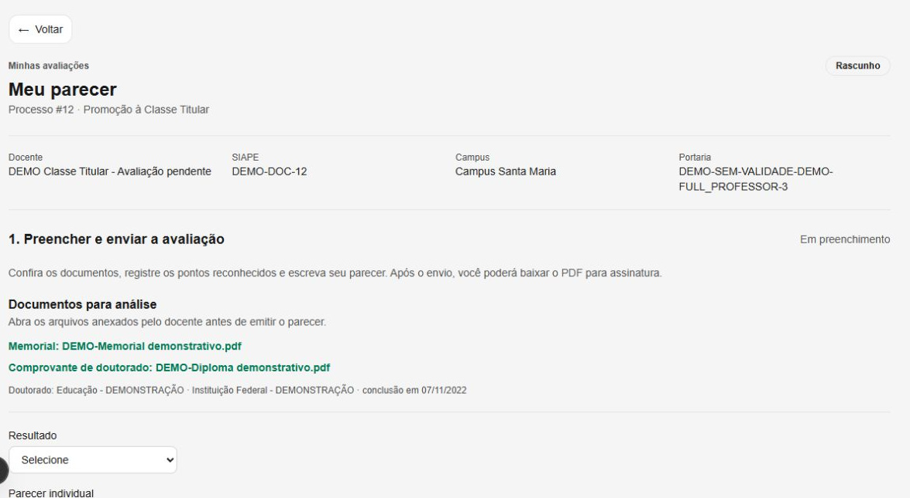

*Tela do parecer individual da Classe Titular com seleção de resultado.*

### Como fazer

1. Abra a tarefa de Classe Titular em Minhas avaliações. Confira a modalidade e os documentos para análise.
2. Analise o memorial ou a tese e os demais documentos disponibilizados para a sua atribuição.
3. Selecione o resultado da avaliação e escreva o Parecer individual de forma fundamentada.
4. Use Salvar rascunho enquanto a análise estiver em elaboração. Clique em Enviar avaliação ao concluir e confira o registro.
5. Baixe seu parecer em PDF, assine na plataforma institucional e envie o documento assinado no painel correspondente.

**Resultado esperado:** O resultado e o parecer do membro entram na consolidação da comissão.

**Orientação:** A CPPD só consegue concluir a comissão depois dos quatro pareceres enviados. O resultado do rito considera a composição e os pareceres registrados; ele não é substituído pelo texto de uma decisão isolada.

## 21 Gerar assinar e conferir documentos

**Quem faz:** Docente avaliadores e CPPD.

A geração, a assinatura externa e a conferência administrativa são etapas distintas. O PDF precisa corresponder ao documento, à versão e ao signatário corretos.

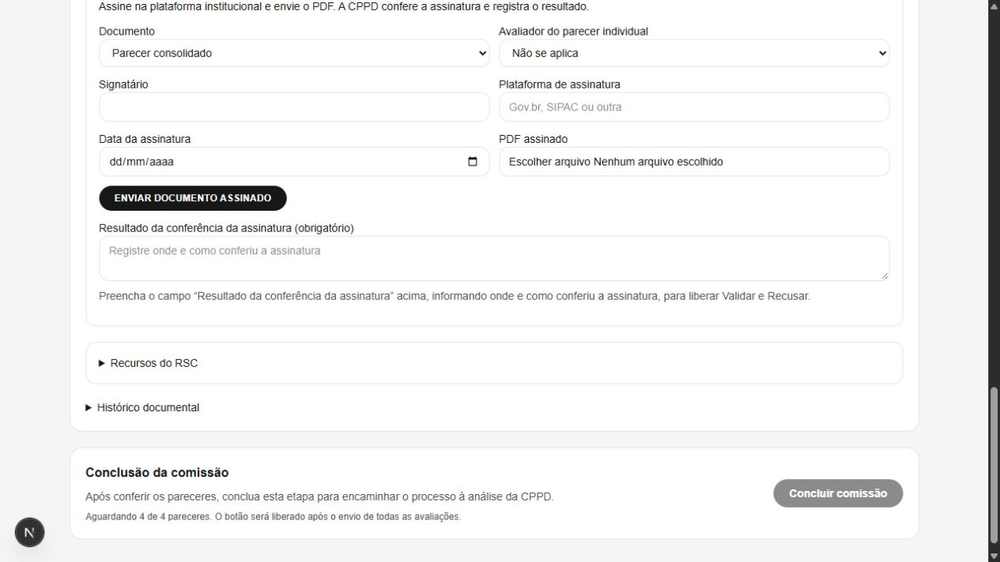

*Painel para enviar PDFs assinados e registrar a conferência.*

### Como fazer

1. Abra Gerar documentos para conferência e assinatura e gere o documento disponível para a etapa. Revise os dados antes de assinar.
2. O signatário assina o PDF na plataforma institucional. Depois, em Documentos assinados e conferência, selecione o tipo do documento e o avaliador quando for um parecer individual.
3. Informe signatário, plataforma e data da assinatura. Selecione o PDF assinado e clique em Enviar documento assinado.
4. A CPPD confere a assinatura na origem e registra onde e como realizou a conferência no campo obrigatório.
5. Use Validar ou Recusar conforme o resultado. Se houver erro, encaminhe uma nova versão do documento e confira a versão atual antes da decisão.

**Resultado esperado:** Os documentos recebidos têm versão e conferência registradas, permitindo a conclusão das etapas que os exigem.

**Orientação:** O campo de assinaturas aceita PDF de até 20 MB. O envio de um PDF sem assinatura não substitui a assinatura na plataforma institucional.

**Orientação:** No RSC, a decisão exige os quatro pareceres individuais e o consolidado assinados e validados. Na Classe Titular, também há documentos próprios, descritos no capítulo de conclusão do rito.

## 22 Concluir a comissão e decidir o RSC

**Quem faz:** CPPD.

A conclusão da comissão e a decisão institucional são registradas depois da avaliação de seus quatro membros.

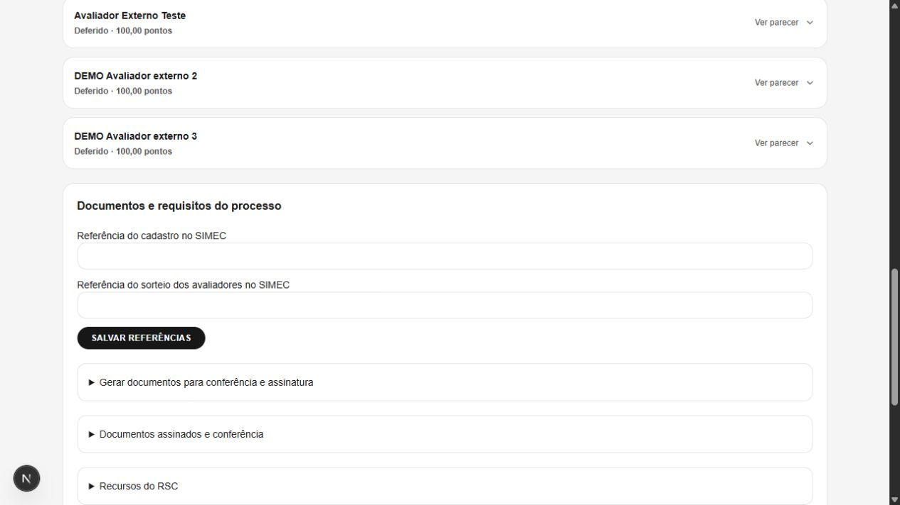

*Área da decisão da CPPD após a conclusão da Comissão Especial.*

### Como fazer

1. Na página Comissão, acompanhe os cartões dos membros e a Consolidação das avaliações. Abra Ver parecer para consultar as fundamentações.
2. Quando todos tiverem enviado seus pareceres, clique em Concluir comissão. Confira a mudança para a etapa de decisão da CPPD.
3. Gere o consolidado e conclua a conferência dos quatro pareceres individuais assinados e do consolidado assinado.
4. Em Decisão da CPPD, preencha o Parecer consolidado e escolha o resultado correspondente aos pareceres. O RSC exige pelo menos três pareceres favoráveis entre os quatro.
5. Confirme a decisão e verifique o resultado nos processos avaliados e na consulta do requerente.

**Resultado esperado:** O RSC é deferido ou indeferido com decisão e documentação vinculadas ao processo.

**Orientação:** Se o sistema apontar documento assinado pendente, confira tipo, membro, versão e validação. Preencher o texto do consolidado não elimina essa exigência.

## 23 Apresentar e acompanhar recursos do RSC

**Quem faz:** Docente CPPD e CPPD Central.

O painel Recursos do RSC fica nos documentos e requisitos do processo. As ações de interposição dependem do indeferimento e do prazo disponível.

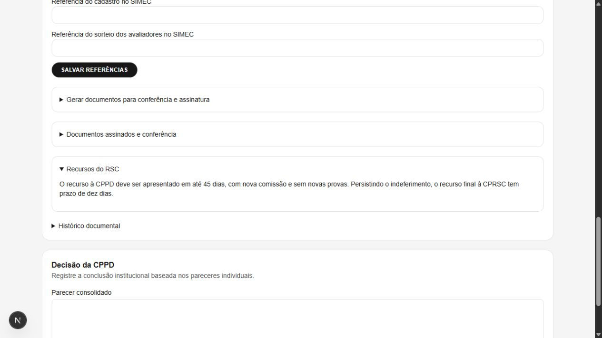

*Painel que orienta os recursos à CPPD e à CPRSC.*

### Como fazer

1. Como docente, abra o processo indeferido e expanda Recursos do RSC. Confira a etapa cabível e o prazo apresentado.
2. Para o recurso à CPPD, registre os fundamentos no prazo de até 45 dias indicado pelo sistema. O recurso preserva as provas e requer uma nova comissão com pessoas diferentes.
3. A CPPD compõe e ativa a nova comissão e acompanha seus quatro pareceres. Repita as etapas de assinatura, conferência e decisão aplicáveis ao recurso.
4. Se o recurso à CPPD permanecer indeferido, o docente pode apresentar o recurso final à CPRSC no prazo de dez dias exibido para essa etapa.
5. A CPPD Central registra a decisão externa da CPRSC com fundamentação, referência do ato e o PDF oficial assinado e validado. Confira o novo resultado no histórico.

**Resultado esperado:** Cada recurso fica associado ao processo e à decisão correspondente, com preservação das provas anteriores.

**Orientação:** Na demonstração, os cinco externos não bastam para duas comissões completas sem repetição dos três externos iniciais. Para testar o recurso com nova banca, prepare pelo menos mais um externo elegível, além do interno 2 e dos externos 4 e 5. Não reutilize membros da comissão original.

## 24 Abrir a Promoção à Classe Titular

**Quem faz:** Docente.

A Classe Titular tem processo próprio para docente em C4. O sistema permite iniciar a preparação após 12 meses em C4 e exige 24 meses completos para a concessão.

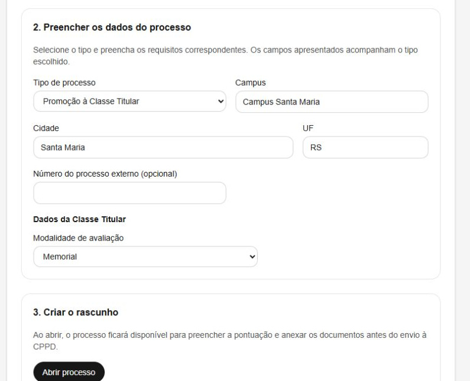

*Campo de modalidade na abertura da Classe Titular; o exemplo mostra Memorial.*

### Como fazer

1. Para os exemplos prontos, use o rascunho 10, o enviado 11 ou a comissão ativa 12. Para uma nova solicitação, abra Abrir processo.
2. Escolha Promoção à Classe Titular e confira identificação, campus e contato.
3. Em Modalidade de avaliação, selecione Memorial ou Tese acadêmica inédita de acordo com o trabalho que será apresentado.
4. Crie o rascunho e confira a modalidade nos detalhes. Cadastre previamente o doutorado na biblioteca do perfil para poder selecioná-lo.
5. Complete os dados do requerimento, a avaliação de desempenho, o diploma, os sete indicados e o arquivo do trabalho antes de enviar.

**Resultado esperado:** O processo fica preparado para os requisitos próprios de Classe Titular.

**Orientação:** O formulário desse tipo não deve ser preenchido como uma Promoção comum C4 para D1. O rito, os documentos e a comissão são próprios.

## 25 Preencher requerimento desempenho e doutorado

**Quem faz:** Docente.

Nos detalhes, expanda as seções de dados do requerimento e de avaliação de desempenho e diploma.

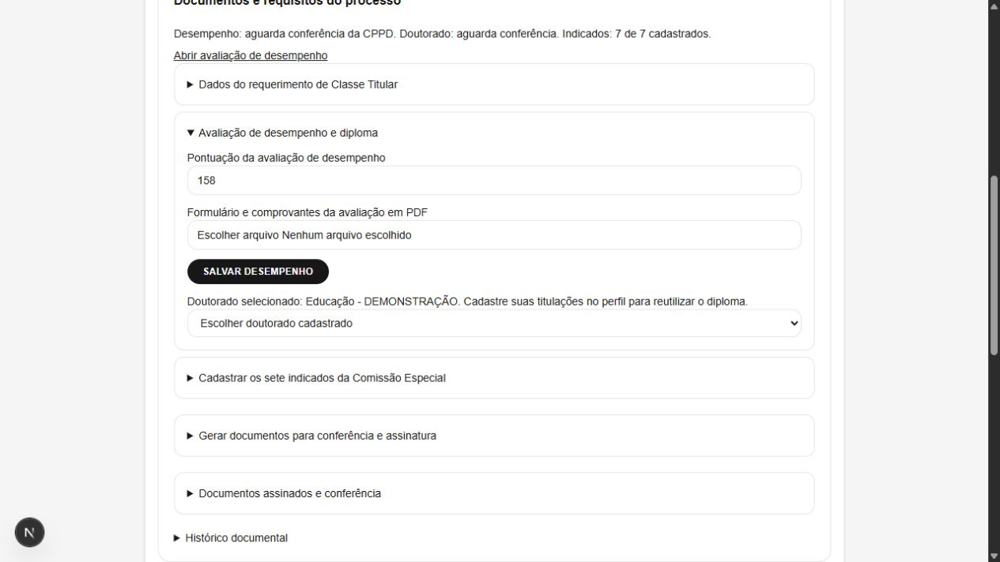

*Campos de desempenho e seleção do doutorado cadastrado.*

### Como fazer

1. Em Dados do requerimento de Classe Titular, informe data de admissão, regime de trabalho e área de concurso. Clique em Salvar dados do requerimento.
2. Em Avaliação de desempenho e diploma, informe a pontuação e anexe o formulário e seus comprovantes em PDF. A pontuação declarada deve ser de pelo menos 120.
3. Clique em Salvar desempenho. Confira o arquivo e o resumo de pendências apresentado pelo processo.
4. Selecione o doutorado cadastrado na biblioteca. Confirme instituição, conclusão e diploma; para diploma estrangeiro, inclua o reconhecimento nacional.
5. Em Documentação específica, anexe o memorial ou a tese da modalidade selecionada. Abra os links para revisar os documentos antes do envio.

**Resultado esperado:** O requerimento, o desempenho e o título estão disponíveis para a análise prévia da CPPD.

**Orientação:** O valor 158 dos exemplos serve apenas à demonstração. Em uma solicitação efetiva, informe a pontuação do documento comprobatório.

## 26 Cadastrar os sete indicados

**Quem faz:** Docente.

A indicação contém sete pessoas. A comissão que efetivamente avalia o processo tem quatro membros titulares.

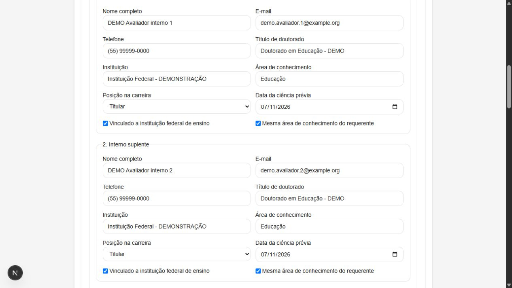

*Detalhe dos campos e declarações de um indicado.*

### Como fazer

1. Expanda Cadastrar os sete indicados da Comissão Especial.
2. Preencha três externos titulares, dois externos suplentes, um interno titular e um interno suplente.
3. Para cada pessoa, informe nome, e-mail, telefone, título de doutorado, instituição, área de conhecimento e posição na carreira.
4. Confirme o vínculo federal e a posição elegível: C4, Titular ou equivalente/superior, conforme o campo. Registre a data da ciência prévia.
5. Se a área for afim, apresente a justificativa solicitada. Confira se os e-mails são distintos e se correspondem às contas que serão escolhidas para a comissão.
6. Clique em Salvar lista de indicados e verifique o resumo de 7 de 7 cadastrados. Complete os demais documentos e envie o processo à CPPD.

**Resultado esperado:** A lista completa fica disponível para a conferência da CPPD e para a composição da comissão.

**Orientação:** Na base preparada, o interno 1 e os externos 1, 2 e 3 são os titulares usados nas comissões. O interno 2 e os externos 4 e 5 completam as suplências da indicação.

## 27 Fazer a análise prévia da Classe Titular

**Quem faz:** CPPD.

A conferência prévia antecede a ativação da Comissão Especial.

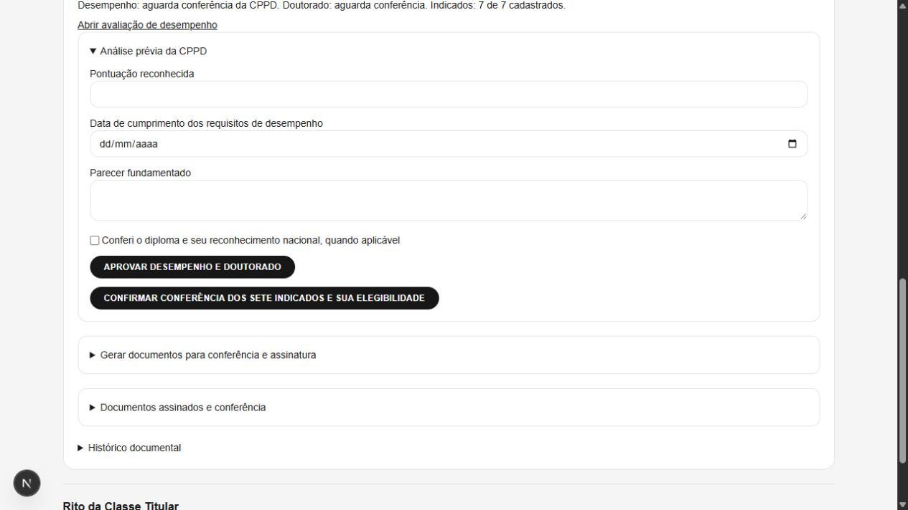

*Painel de conferência do desempenho, título e indicados pela CPPD.*

### Como fazer

1. Em Processos, abra Comissão na solicitação de Classe Titular. Expanda Análise prévia da CPPD.
2. Abra a avaliação de desempenho, registre os pontos reconhecidos e a data de cumprimento dos requisitos. Escreva a fundamentação da análise.
3. Confira o diploma e seu reconhecimento, quando necessário, e confirme a aprovação do doutorado.
4. Clique em Aprovar desempenho e doutorado. Depois confira títulos, vínculos, área, elegibilidade e ciência dos sete indicados e registre essa confirmação.
5. Constitua a comissão com o interno titular como presidente e os três externos titulares. Registre a portaria, obtenha todos os aceites e ative a comissão.

**Resultado esperado:** O processo segue para a avaliação com desempenho, doutorado e indicados conferidos.

**Orientação:** A validação prévia e os documentos assinados são registros complementares. Na conclusão, o parecer assinado de desempenho e doutorado também precisa estar conferido.

## 28 Seguir as modalidades Memorial e Tese

**Quem faz:** Docente avaliadores e CPPD.

A modalidade escolhida determina o trabalho apresentado e as etapas seguintes do rito.

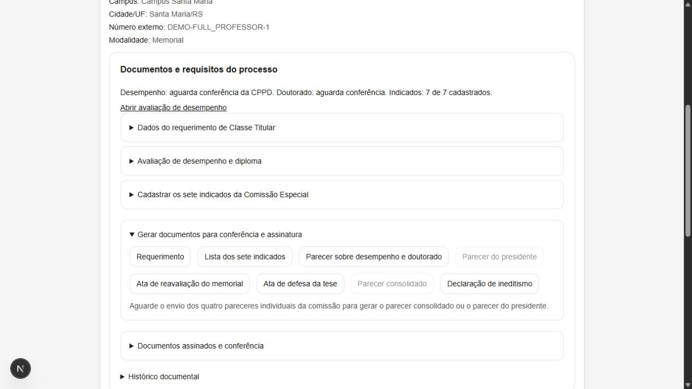

*Geração dos documentos disponíveis, incluindo os próprios de memorial e tese.*

### Como fazer

1. No Memorial, apresente o trabalho e os documentos próprios. Cada membro analisa o material e envia seu parecer individual.
2. Na Tese acadêmica inédita, anexe a tese e registre a declaração de ineditismo no painel do docente. Gere, assine e envie a declaração exigida.
3. Para Tese, a CPPD agenda a defesa na área Rito da Classe Titular enquanto a comissão está ativa. Informe a data futura e o endereço da sala virtual.
4. Depois da sessão, a CPPD registra data realizada, gravação e ata. Só então conclui a comissão com os quatro pareceres enviados.
5. Confira o resultado do rito. A aprovação inicial segue para conclusão documental; uma reprovação abre a etapa cabível de reavaliação do memorial ou recurso.

**Resultado esperado:** A solicitação segue as etapas da modalidade escolhida e apresenta os documentos pertinentes.

**Orientação:** Na decisão de Titular, são necessários os documentos gerais da comissão e o parecer do presidente. Tese também exige declaração de ineditismo e ata de defesa assinadas e conferidas. O memorial com defesa de reavaliação exige a ata correspondente.

## 29 Pedir reavaliação do memorial

**Quem faz:** Docente.

Após resultado inicial desfavorável do Memorial, o rito pode ficar em Aguardando pedido de reavaliação.

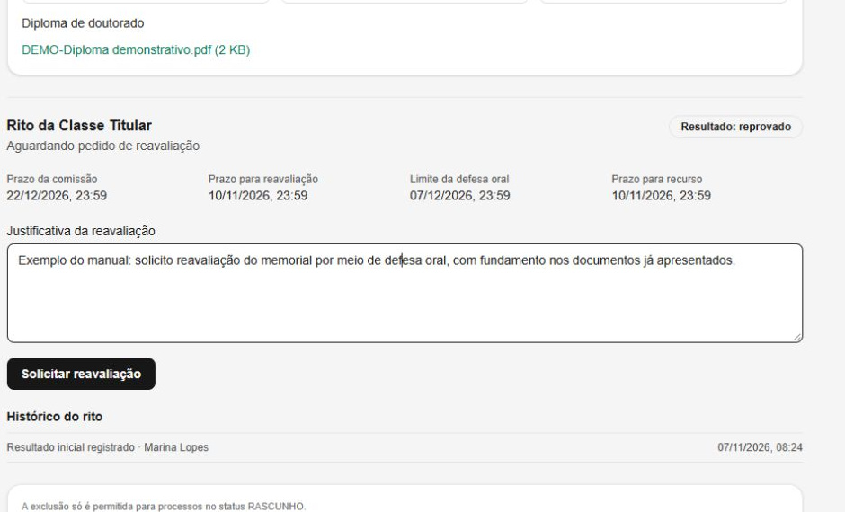

*Pedido de reavaliação do memorial com justificativa e prazos.*

### Como fazer

1. Abra os detalhes do processo e localize Rito da Classe Titular.
2. Confira o resultado inicial e as datas apresentadas. O sistema disponibiliza o pedido de reavaliação no prazo de dois dias úteis dessa etapa.
3. Preencha a Justificativa da reavaliação e clique em Solicitar reavaliação.
4. Acompanhe a confirmação e o histórico. A CPPD passa a organizar a defesa oral dentro do limite exibido.

**Resultado esperado:** O rito passa a Reavaliação solicitada e o pedido fica registrado no histórico.

**Orientação:** Os prazos mostrados pelo sistema consideram as datas e o calendário registrados. A conferência do parecer assinado do presidente pode atualizar o marco das datas; confira a tela atual antes de agir.

## 30 Agendar e registrar uma defesa

**Quem faz:** CPPD.

A área Rito da Classe Titular apresenta as ações de agendamento e registro conforme a modalidade e a situação.

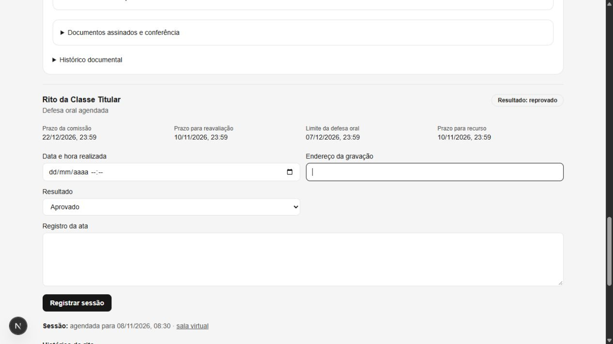

*Registro de sessão de reavaliação do Memorial; a tela da Tese segue a modalidade própria.*

### Como fazer

1. Quando Agendar defesa estiver disponível, selecione uma data e hora futuras, informe o endereço da sala virtual e confirme o agendamento.
2. Após a realização, abra o registro da sessão. Informe a data e hora realizadas e o endereço da gravação.
3. Preencha o Registro da ata. Na reavaliação do Memorial, registre também o resultado da defesa. Na Tese, os pareceres individuais compõem o resultado do rito.
4. Clique em Registrar sessão e confira o histórico. Gere a ata da modalidade, providencie a assinatura e registre o PDF assinado para conferência.
5. Se persistir resultado desfavorável, observe o prazo e o formulário de recurso. Se o rito estiver concluído, avance para a decisão final e seus documentos.

**Resultado esperado:** A sessão e seus documentos ficam vinculados ao processo e o rito avança à próxima etapa.

**Orientação:** A gravação e a ata devem descrever a sessão efetivamente realizada. Um agendamento futuro não comprova a realização da defesa.

## 31 Recorrer e concluir a Classe Titular

**Quem faz:** Docente e CPPD.

A decisão final da CPPD acompanha o resultado do rito e depende dos documentos exigidos na modalidade.

### Como fazer

1. Se o rito apresentar Aguardando recurso, o docente preenche os fundamentos e usa Apresentar recurso dentro do prazo de dois dias úteis disponibilizado pelo sistema.
2. A CPPD registra o resultado do recurso e a decisão fundamentada. Quando cabível, pode encerrar um prazo vencido sem manifestação pela ação específica da tela.
3. Confira a conclusão do rito e os quatro pareceres enviados. Para deferimento, o docente precisa completar 24 meses em C4 e cumprir os demais requisitos.
4. Confira as versões assinadas e validadas de todos os documentos da tabela abaixo. Se algum requisito mudar, revise também a versão documental afetada.
5. Na área Decisão da CPPD, preencha o consolidado e registre o resultado compatível com o rito. Confirme a decisão e confira situação, fundamentação e efeitos financeiros no acompanhamento.

| Documento | Quando conferir |
| --- | --- |
| Quatro pareceres individuais e consolidado | Em todos os processos de Titular |
| Parecer do presidente | Em todos os processos de Titular |
| Parecer de desempenho e doutorado | Depois da análise prévia atual |
| Declaração de ineditismo e ata da tese | Na modalidade Tese |
| Ata de reavaliação do memorial | Quando houver a defesa de reavaliação |

**Resultado esperado:** A Classe Titular tem resultado final documentado e consultável pelos participantes autorizados.

## 32 Administrar usuários e vínculos da CPPD

**Quem faz:** Administrador ou CPPD Central conforme a função.

Os cadastros e vínculos sustentam o acesso ao campus e às funções do sistema.

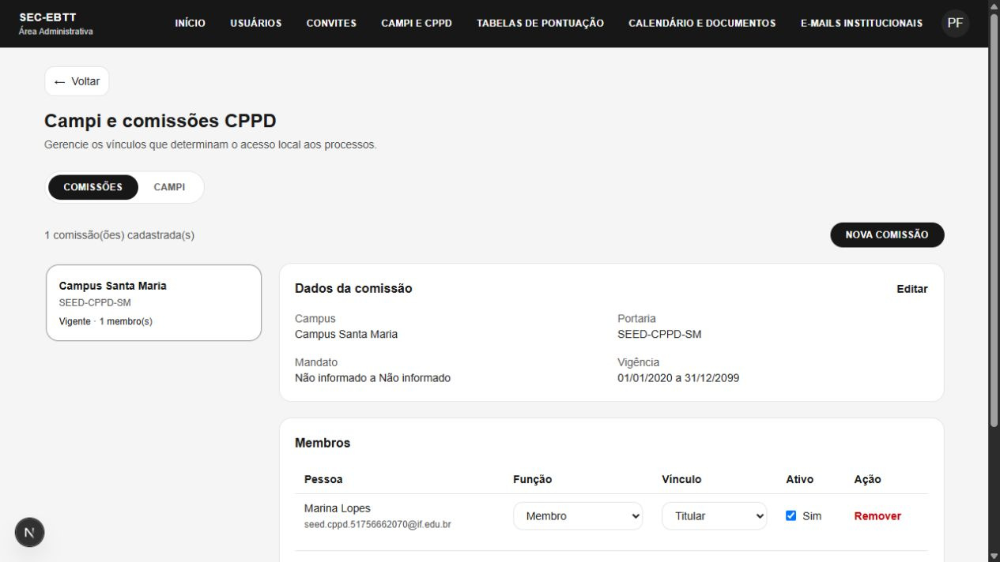

*Comissão local com dados de vigência, membros e ações de vínculo.*

### Como fazer

1. Em Usuários, pesquise por nome, e-mail, CPF ou SIAPE. Abra a edição da pessoa correta e confira os perfis e os dados necessários.
2. Para autorizar primeiro acesso, use Convites. Selecione campus, nome, e-mail institucional e os perfis permitidos. Para externo de outro domínio, confirme a instituição conforme o formulário.
3. Acompanhe o cadastro. Quando houver revisão, use Conferir dados profissionais e, após verificar as informações, Aprovar cadastro e liberar avaliador.
4. Em Campi e CPPD, selecione a comissão local. Confira campus, portaria e vigência antes de editar ou criar um vínculo.
5. Em Membros, associe a pessoa, a função e a titularidade. Mantenha o vínculo ativo e vigente para permitir a atuação local no campus.

**Resultado esperado:** As pessoas têm o acesso correspondente ao seu papel e ao campus autorizado.

**Orientação:** Os convites de acesso têm prazo informado de sete dias; Reenviar invalida o link anterior. Um convite de acesso é diferente do convite para participar de uma Comissão Especial.

**Orientação:** A base do orientador já contém as contas e a CPPD local necessárias. Altere vínculos de teste com cuidado para não retirar o acesso da conta usada na rodada.

## 33 Manter tabelas calendário e documentos

**Quem faz:** Administrador ou CPPD Central conforme o recurso.

As configurações determinam os critérios vigentes, os prazos e os documentos apresentados em cada tipo de processo.

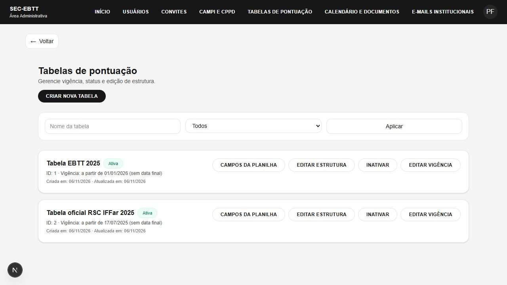

*Catálogos de carreira e RSC com situação e vigência.*

### Como fazer

1. Em Tabelas de pontuação, confira finalidade, situação e vigência. O processo usa a tabela fixada na sua abertura.
2. Para preparar critérios, trabalhe em rascunho. Estruturas de tabelas ativas ficam protegidas; faça a nova versão necessária antes de mudar os critérios usados em solicitações.
3. Em Calendário e documentos, cadastre feriados, férias e recessos com descrição, fonte, campus e intervalo correto.
4. Em Versões dos modelos, informe documento, nome, versão e conteúdo e salve a nova versão.
5. Em Documentos obrigatórios por processo, confira as exigências. Se o tipo já tiver processos, crie uma nova versão do tipo para preparar mudanças sem reescrever exigências anteriores.

**Resultado esperado:** Os processos utilizam configurações coerentes com sua versão e com as datas registradas.

**Orientação:** A demonstração já contém as duas tabelas usadas nos cenários. Os períodos de calendário devem corresponder às datas oficiais aplicáveis; o manual não cadastra feriados fictícios.

## 34 Resolver pendências frequentes

**Quem faz:** Todos os perfis.

Leia a mensagem e confira a etapa antes de repetir a operação. Os bloqueios abaixo indicam o que precisa ser revisado.

| Situação | O que conferir |
| --- | --- |
| O processo não aparece | Conta, perfil, campus, aba de pendentes ou avaliados e número escolhido. |
| Já existe processo ativo | Use o cenário existente do mesmo tipo ou conclua a solicitação antes de abrir outra. |
| Não consigo lançar pontos | Situação editável, comprovante vinculado, quantidade e teto do item. |
| Não consigo enviar | Campos, documentos, período e pontuação; no RSC, também os 36 pontos no nível pretendido. |
| Gerar parecer está bloqueado | Todos os itens preenchidos pelo docente precisam estar avaliados. |
| Avaliador não foi encontrado | E-mail do cadastro, conta ativa, perfil correto e aprovação do cadastro externo. |
| Avaliação não está disponível | Aceite do convite, ausência de conflito declarada, comissão ativa e pessoa designada. |
| Concluir comissão está bloqueado | Quatro pareceres enviados; na Tese, confira o registro da defesa. |
| Decisão exige assinaturas | Tipo, membro, versão atual, PDF recebido e conferência registrada. |
| O PDF não abriu no painel | Use o link de abertura ou download e confira a leitura em outro navegador com suporte a PDF. |
| O prazo não permite a ação | Datas do rito, assinatura conferida e calendário aplicável. Não altere o relógio para contornar o prazo. |

**Resultado esperado:** A pendência foi identificada e a próxima ação corresponde ao perfil e à situação do processo.

**Orientação:** Ao relatar uma dificuldade, anote número do processo, perfil, ação, mensagem e resultado esperado. Um print da mensagem ajuda a reproduzir a situação.

**Orientação:** Para retomar a demonstração, peça a Julio a preparação da base. O comando seed:demo preserva o andamento; o reset demonstrativo recria os cenários iniciais e gera backup.

## 35 Credenciais de gestão e avaliação

**Quem faz:** Consulta das contas demonstrativas.

Estas são as credenciais iniciais do ambiente preparado. As contas internas 1 e externa 1, 2 e 3 participam das comissões dos processos 9 e 12. As demais completam os indicados de Titular.

| Conta | CPF | Senha inicial |
| --- | --- | --- |
| Administrador | 81188057006 | Admin@123456 |
| CPPD local Marina Lopes | 51756662070 | Cppd@123456 |
| CPPD Central | 58315013610 | CppdCentral@123456 |
| Avaliador interno 1 | 91000010074 | Demo@123456 |
| Avaliador interno 2 | 91000010155 | Demo@123456 |
| Externo 1 Avaliador Externo Teste | 52998224725 | Avaliador@123456 |
| Avaliador externo 2 | 91000010317 | Demo@123456 |
| Avaliador externo 3 | 91000010406 | Demo@123456 |
| Avaliador externo 4 | 91000010589 | Demo@123456 |
| Avaliador externo 5 | 91000010660 | Demo@123456 |

**Resultado esperado:** Use a conta do papel que executará a próxima etapa e faça Sair antes de trocar de pessoa.

**Orientação:** O avaliador interno entra com perfil Docente e abre Minhas avaliações. O externo usa o módulo de Avaliações.

**Orientação:** Compartilhe este manual com as pessoas autorizadas a testar a demonstração. Se uma senha tiver sido alterada, use a senha atual.

## 36 Contas docentes e pontos de partida

**Quem faz:** Consulta das contas demonstrativas.

As contas desta tabela usam Demo@123456, exceto Docente Teste, que usa Docente@123456. Cada pessoa tem um cenário diferente para evitar conflito entre solicitações ativas.

| Docente ou cenário | CPF | Processo | Etapa inicial |
| --- | --- | --- | --- |
| Docente Teste Progressão | 65033520008 | 1 | Rascunho |
| Progressão enviada | 91000000273 | 2 | Enviado |
| Progressão em análise | 91000000354 | 3 | Análise CPPD |
| Promoção em rascunho | 91000000435 | 4 | Rascunho |
| Promoção enviada | 91000000516 | 5 | Enviado |
| Promoção em análise | 91000000605 | 6 | Análise CPPD |
| RSC I em rascunho | 91000000788 | 7 | Rascunho |
| RSC II enviado | 91000000869 | 8 | Enviado |
| RSC III em avaliação | 91000000940 | 9 | Comissão ativa |
| Titular em rascunho | 91000001083 | 10 | Rascunho |
| Titular enviado | 91000001164 | 11 | Enviado |
| Titular em avaliação | 91000001245 | 12 | Comissão ativa |

**Resultado esperado:** O rascunho serve ao docente; o enviado serve à CPPD; a avaliação pendente permite continuar a análise ou os pareceres.

**Orientação:** Os nomes apresentados na tela começam com DEMO nas contas de cenário; Docente Teste é a conta básica reaproveitada.

**Orientação:** As telas deste manual incluem avanços realizados na cópia de captura. Os pontos de partida acima descrevem a base inicial entregue ao orientador.
